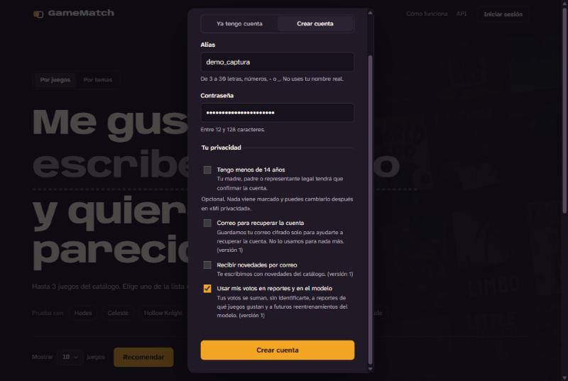
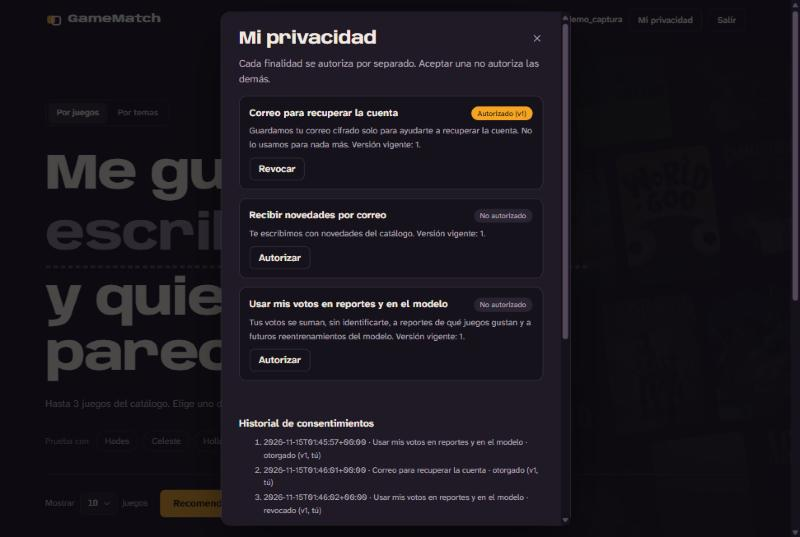
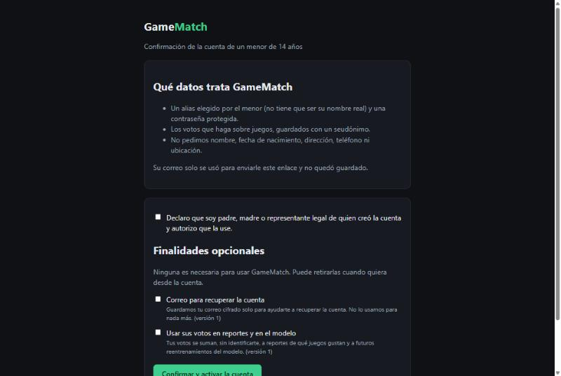
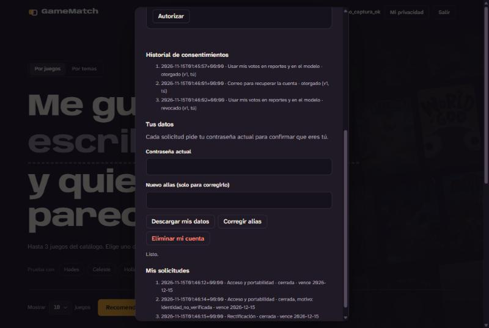

# Informe técnico: Hito 3, consentimiento, derechos, auditoría y respuesta a incidentes en GameMatch

**Asignatura:** DevOps (Sec/ML)

**Integrantes:** Nicolás Bravo, Maximiliano Mella, Martín Lorca

**Repositorio:** https://github.com/niclasbravo/DevOps

**Fecha:** 15 de noviembre de 2026

## Resumen

GameMatch es una API FastAPI con una página web que recomienda videojuegos indie. En los Hitos 1 y 2 se le agregaron cuentas con Argon2id, control de acceso por roles leído de la base, votos seudonimizados con HMAC, correo cifrado y una auditoría de solo inserción.

En este hito se implementaron, sobre esa base, cuatro mecanismos:

- **Consentimiento por finalidad**, con versión del texto, historial, revocación y un flujo para menores de 14 años con su representante legal.
- **Ejercicio de derechos:** acceso y portabilidad, rectificación y supresión, con verificación de identidad y un flujo de solicitudes con estados y plazos.
- **Auditoría íntegra**, con cadena HMAC, política de conservación y seis reglas de alerta.
- **Plan de respuesta a incidentes**, con comandos técnicos de contención y recuperación.

Todo está en el código y lo comprueban 436 pruebas automatizadas, un recorrido real de los flujos y capturas de pantalla. El trabajo se entregó en Pull Requests revisados, con CI.

**Marco normativo.** Se usa la Ley 19.628 modificada por la Ley 21.719, cuya vigencia legal es el 1 de diciembre de 2026. Se aplican estas reglas:

| Regla | Origen | Uso en el sistema |
|---|---|---|
| Menores de 14 años: consienten sus padres o representantes legales | Art. 16 quáter | Flujo diferenciado para menores |
| Responder las solicitudes de derechos en 30 días corridos, prorrogables una vez | Art. 11 | Campo `due_on` y prórroga única |
| Reportar a la Agencia las vulneraciones con riesgo razonable, sin dilaciones indebidas | Art. 14 sexies | Plan de incidentes |
| Avisar a los titulares si se afectan datos sensibles, de menores de 14 o económicos | Art. 14 sexies | El sistema sabe qué cuentas son de menores |

La Ley 21.663, Marco de Ciberseguridad, obliga a servicios esenciales y operadores de importancia vital. GameMatch no es ninguno de los dos, así que sus plazos no se aplican.

## Bases de licitud

El consentimiento no es la base de todo. Pedirlo para lo que el servicio necesita sí o sí lo convertiría en una condición, y la ley exige que sea libre.

| Tratamiento | Datos | Base | Si no se otorga o se retira |
|---|---|---|---|
| Cuenta e inicio de sesión | Alias, hash de la contraseña, `is_child` | Ejecución del servicio | No hay cuenta |
| Guardar y mostrar los votos | Seudónimo, juego, voto, fecha | Ejecución del servicio | No puede votar |
| Seguridad y auditoría | `audit_log`, `security_alerts` | Deber de seguridad | No se puede retirar |
| Correo de recuperación | Correo cifrado | Consentimiento `correo_recuperacion` | No se guarda correo; al revocar se borra |
| Votos en reportes y en el modelo | Votos agregados | Consentimiento `votos_analitica` | Sus votos quedan fuera |
| Novedades por correo | Correo cifrado | Consentimiento `novedades_correo` | No recibe novedades |
| Toda la cuenta de un menor de 14 | Todo lo anterior | Consentimiento del representante | La cuenta no se activa |

## 1. Diseño del módulo de consentimiento

### 1.1 Finalidades y versiones

Las finalidades se guardan en `consent_purposes`, con el texto informado y su versión. Un cambio importante del texto sube la versión, y los textos anteriores quedan en `consent_purpose_versions` para saber qué aceptó cada persona.

| Finalidad | Texto informado (resumen) | Versión | Menores de 14 |
|---|---|---|---|
| `correo_recuperacion` | Guardamos tu correo cifrado solo para ayudarte a recuperar la cuenta | 1 | Solo si la otorga el representante |
| `votos_analitica` | Tus votos se suman, sin identificarte, a reportes y a futuros reentrenamientos | 1 | Solo si la otorga el representante |
| `novedades_correo` | Te escribimos con novedades del catálogo | 1 | No disponible: es comunicación comercial |

### 1.2 Estructura de datos

```sql
CREATE TABLE consent_events (
  id INTEGER PRIMARY KEY,
  subject TEXT NOT NULL,          -- HMAC(account.id): mismo seudónimo que los votos
  purpose TEXT NOT NULL REFERENCES consent_purposes(code),
  text_version TEXT NOT NULL,     -- versión del texto que se aceptó
  status TEXT NOT NULL CHECK (status IN ('otorgado', 'revocado')),
  actor TEXT NOT NULL CHECK (actor IN ('titular', 'representante', 'sistema')),
  ts TEXT NOT NULL                -- fecha y hora UTC, en segundos
);
```

- **Se guardan eventos, no un estado que se sobrescribe.** El estado actual es el último evento de cada finalidad. El historial y la fecha de cada revocación salen de la misma tabla.
- **Un trigger impide reescribir los eventos**, y otro solo permite borrar los de más de 365 días.
- **El titular se identifica por su seudónimo**, sin clave foránea a las cuentas, igual que los votos.
- **Minimización:** no se guardan IP, navegador ni ubicación. Tampoco una copia del texto por evento: se guarda su versión.

### 1.3 Reglas

- **Una finalidad solo vale para sí misma y para su versión vigente.** La única función que responde si hay consentimiento es `has_consent(seudónimo, finalidad)`. Devuelve verdadero solo si el último evento es `otorgado` y su versión es la vigente; si el texto cambia, hay que renovar el consentimiento.
- **Nada viene marcado.** El registro envía la lista de finalidades aceptadas, y una finalidad ausente no se otorga.
- **Ninguna finalidad habilita otra.** Cada proceso consulta su propia finalidad. Tener un correo guardado para recuperación no permite enviar novedades: el envío exige `novedades_correo`, y una prueba lo comprueba.
- **Revocar es tan fácil como otorgar:** una sola petición.
- **Un menor de 14 no puede otorgar,** pero sí revocar, porque retirar siempre lo protege.

### 1.4 Efecto de la revocación en los procesos

| Finalidad | Proceso que depende de ella | Efecto de revocar |
|---|---|---|
| `correo_recuperacion` | Recuperación manual de la cuenta | El correo cifrado se borra en la misma transacción |
| `votos_analitica` | Reporte de votos y reentrenamiento | La consulta SQL del reporte solo cuenta seudónimos con consentimiento vigente |
| `novedades_correo` | Envío de novedades | Los destinatarios se calculan en cada envío, así que la revocación rige en el siguiente |

El filtro está en la consulta a la base, no en la página, así que ningún cliente puede saltárselo.

### 1.5 Flujo diferenciado para menores de 14 años

El flujo aplica porque GameMatch está abierto a cualquier persona, y los videojuegos indie tienen público menor de edad.

1. El registro pregunta si la persona tiene menos de 14 años. No se pide fecha de nacimiento: solo se guarda `is_child`, que es lo que cambia las reglas.
2. Si la respuesta es sí, se exige el correo del representante. La cuenta queda pendiente y no puede iniciar sesión.
3. El sistema genera un token aleatorio de 32 bytes. Guarda solo su SHA-256, con vencimiento de 72 horas, y envía el enlace al representante. **El correo del representante no se guarda.**
4. La página del representante explica qué datos se tratan y qué finalidades están disponibles. Para activar la cuenta, el representante declara serlo y elige las finalidades.
5. La confirmación activa la cuenta y registra cada consentimiento con `actor = representante`. El enlace sirve una sola vez.
6. Si nadie confirma en 72 horas, `purge-retention` borra la cuenta pendiente.

El cambio de edad no se puede hacer por autoservicio: queda en evaluación de un administrador, porque si no bastaría rectificar la edad para saltarse al representante. **Límite:** el sistema verifica la posesión del correo y una declaración, no la relación legal. Se acepta porque los datos tratados son de bajo riesgo, y una verificación más fuerte exigiría recolectar más datos de los que protege.

### 1.6 Interfaces

| Endpoint | Permiso | Uso |
|---|---|---|
| `GET /consents/purposes` | Público | Finalidades vigentes con texto y versión |
| `GET /me/consents` | `consent:manage` | Estado actual por finalidad |
| `GET /me/consents/history` | `consent:manage` | Historial propio |
| `POST /me/consents/{finalidad}` | `consent:manage` | Otorgar la versión vigente |
| `DELETE /me/consents/{finalidad}` | `consent:manage` | Revocar |
| `POST /guardian/confirm` | Token de un solo uso | Confirmación del representante |







## 2. Documento de ejercicio de derechos

### 2.1 Flujo de las solicitudes

Toda solicitud entra por `POST /me/requests` y recorre recepción, verificación, evaluación, ejecución o respuesta fundada, y cierre. Cada paso guarda su fecha.

```
recibida → verificada → en_evaluacion → ejecutada → cerrada
                    ↘                ↘ rechazada  ↗
                     rechazada (identidad no verificada)
```

La tabla `rights_requests` guarda tipo, estado, fechas de cada paso, vencimiento (recepción más 30 días corridos), si se usó la prórroga única y un motivo de una lista cerrada:

- `identidad_no_verificada`
- `ultimo_admin`
- `conservacion_por_incidente`
- `dato_invalido`
- `alias_no_disponible`

**No guarda los datos pedidos.** Así, probar que una solicitud se atendió en plazo no obliga a conservar datos personales.

Los casos que necesitan criterio humano quedan en evaluación. Un administrador los resuelve con `POST /admin/requests/{id}/decision`, y puede ejecutar, rechazar con motivo o prorrogar una sola vez. `GET /admin/requests` marca las solicitudes vencidas.

### 2.2 Verificación de identidad proporcional

| Operación | Verificación | Por qué |
|---|---|---|
| Ver consentimientos y solicitudes | Sesión válida | Solo lectura de metadatos propios |
| Acceso y portabilidad | Sesión y contraseña actual | Entrega todos los datos en un archivo |
| Rectificación | Sesión y contraseña actual | Cambia el alias o el correo |
| Supresión | Sesión y contraseña actual | Es irreversible |

- **No se piden datos nuevos**, como un documento o preguntas de seguridad. La contraseña es la prueba más fuerte que el sistema tiene sin recolectar más.
- **Un error de contraseña cuenta para el bloqueo de 5 intentos.** Una cuenta bloqueada no puede solicitar, aunque acierte.

### 2.3 Acceso y portabilidad

La respuesta es un archivo JSON descargable, legible por personas y por programas, con versión de formato (`gamematch-export/1`). Incluye:

- la cuenta y el correo descifrado, que es dato del titular,
- los consentimientos,
- los votos,
- las solicitudes.

**Se excluye a propósito:**

- el hash de la contraseña,
- el identificador interno y los seudónimos,
- los contadores de bloqueo,
- la auditoría, que es un registro interno con seudónimos de administradores, o sea de terceros,
- los datos de otras personas.

La exportación queda auditada como `data:export`. En la sección 6 hay un ejemplo real.

### 2.4 Rectificación

| Campo | Validación | Efecto en otros módulos |
|---|---|---|
| Alias | Patrón sin `@` y único | Ninguno: votos, consentimientos y auditoría usan el seudónimo del id, no el alias |
| Correo | Formato válido y `correo_recuperacion` vigente | Se cifra y reemplaza. El envío de novedades lee el correo en cada envío |
| Menor de 14 | Ninguna automática | Queda en evaluación sin guardar el valor pedido |

El modelo de entrada rechaza cualquier campo no previsto, así que no se puede rectificar el rol ni el id. La auditoría registra qué campos cambiaron (`campos=alias`), nunca el valor anterior ni el nuevo.

### 2.5 Supresión

Se ejecuta en una sola transacción:

1. Se borran los votos.
2. Se revocan los consentimientos vigentes, con `actor = sistema`.
3. Se borra la cuenta, con su correo cifrado.
4. Se audita `data:delete`.

| Situación | Resultado | Fundamento |
|---|---|---|
| Es el último administrador activo | Rechazada, `ultimo_admin` | Integridad del servicio |
| La cuenta está retenida por un incidente en investigación | En evaluación, `conservacion_por_incidente` | Conservar evidencia mientras dura la investigación |

| Registro | Se conserva | Motivo | Plazo |
|---|---|---|---|
| Auditoría | Sí, seudonimizada | Deber de seguridad | 365 días |
| Eventos de consentimiento | Sí, seudonimizados | Probar que los tratamientos pasados tuvieron base | 365 días |
| Solicitudes | Sí, sin datos | Probar que se atendió en plazo | 365 días desde el cierre |

Tras la supresión, el id ya no existe y el seudónimo no se puede recalcular desde el sistema, así que los datos borrados no vuelven a usarse en ningún proceso.

**Copias:** si se restaura una copia, `python -m app.cli reapply-deletions` vuelve a borrar las cuentas cuya supresión ya se había ejecutado. La imagen Docker y los artefactos de CI no contienen datos personales. El antiguo `DELETE /me`, que borraba sin pedir contraseña, se eliminó.



## 3. Diseño del registro de auditoría

### 3.1 Eventos registrados

| Categoría | Acciones |
|---|---|
| Autenticación | `auth:register`, `auth:login` (exitoso y fallido), `auth:guardian_confirm` |
| Consentimiento | `consent:grant`, `consent:revoke` |
| Derechos | `rights:<tipo>`, `data:export`, `data:rectify`, `data:delete`, `requests:extend`, `requests:reject` |
| Cuenta propia | `me:update` |
| Administración | `accounts:read`, `accounts:manage`, `accounts:reveal_email`, `accounts:legal_hold` |
| Seguridad | Toda denegación por permisos, `alert:<regla>`, `alert:update`, `audit:read`, `audit:verify`, `audit:purge` |
| Contención | `admin:revoke_sessions`, `admin:disable_account`, `system:read_only`, `system:export_evidence` |

### 3.2 Atributos

| Columna | Contenido |
|---|---|
| `event_id` | UUID, para citar el evento en un informe de incidente |
| `ts` | Fecha y hora UTC, en segundos |
| `actor_pseudonym`, `target_pseudonym` | HMAC de los identificadores de la cuenta que actúa y de la afectada |
| `action`, `outcome` | Operación y resultado (`permitido` o `denegado`) |
| `resource` | Recurso por referencia: `consent:votos_analitica`, `account`, `audit_log` |
| `detail` | Código sin datos personales: `campos=alias`, `motivo=dato_invalido` |
| `prev_hash`, `hash` | Cadena de integridad |

### 3.3 Información que no se registra

No se registran:

- contraseñas, ni siquiera cuando son erróneas,
- tokens JWT ni tokens del representante,
- claves criptográficas,
- correos y alias,
- el valor anterior o nuevo de una rectificación,
- el contenido de una exportación,
- cuerpos de peticiones,
- direcciones IP,
- identificadores de cuenta sin seudonimizar.

El filtro de logs del Hito 2 sigue redactando correos, tokens e identificadores en los registros de la aplicación.

**Justificación.** Para investigar un incidente basta saber qué seudónimo hizo qué, sobre qué recurso, cuándo y con qué resultado. Quien investiga con autorización puede recalcular el HMAC de una cuenta concreta y buscarla, pero quien solo lee la auditoría no sabe quién es quién. Registrar valores convertiría la auditoría en una segunda copia de los datos personales, con el mismo riesgo de filtración.

### 3.4 Protección

- **Sin modificación:** un trigger bloquea toda actualización.
- **Sin borrado indebido:** otro trigger solo permite borrar filas de más de 365 días.
- **Detección de alteraciones:** cada fila guarda `HMAC-SHA256(GM_AUDIT_KEY, hash anterior | campos)`, con una clave propia distinta de las demás. Si alguien edita el archivo SQLite saltándose los triggers, no puede recalcular la cadena sin la clave. `verify-audit` lo detecta y abre una alerta crítica.
- **Escritura serializada:** cada inserción ocurre en una transacción inmediata, para que dos eventos simultáneos no compartan el mismo hash anterior.
- **Sin clave no hay operación:** si falta `GM_AUDIT_KEY`, todo lo que se audita responde 503.

### 3.5 Acceso

Solo el rol `admin`, con el permiso `audit:read`, puede consultar la auditoría, y cada lectura queda registrada. Ningún rol puede modificarla ni borrarla por la API.

### 3.6 Conservación y eliminación segura

`python -m app.cli purge-retention`, pensado para correr una vez al día, borra:

- las filas de auditoría, consentimientos y alertas de más de 365 días, conservando el último evento de consentimiento de las cuentas que siguen existiendo,
- las solicitudes cerradas hace más de 365 días,
- las cuentas de menores cuyo enlace venció.

Antes de purgar registra `audit:purge` con la cantidad de filas, y guarda el último hash eliminado como ancla para que la cadena siga verificable. Los 365 días son una decisión del equipo: cubren un ciclo de investigación y reclamos.

### 3.7 Detección y alertas

Las reglas se evalúan en la misma transacción que el evento que las dispara.

| Regla | Condición | Severidad |
|---|---|---|
| `login_fallido_reiterado` | 5 inicios fallidos sobre una cuenta en 15 minutos | Media |
| `posible_fuerza_bruta` | 20 inicios fallidos en total en 5 minutos | Alta |
| `exportacion_anomala` | Más de 3 exportaciones del mismo titular en 24 horas | Media |
| `acceso_denegado_reiterado` | 10 denegaciones del mismo actor en 10 minutos | Media |
| `revelacion_masiva` | Más de 5 revelaciones de correo del mismo admin en 1 hora | Alta |
| `integridad_auditoria` | La cadena de auditoría está rota | Crítica |

Una regla no abre otra alerta igual mientras haya una sin cerrar, para no inundar la tabla. Los estados implementan la distinción del plan:

- **abierta:** es una alerta,
- **en análisis:** es un evento sospechoso,
- **incidente:** es un incidente confirmado, y activa el plan.

## 4. Plan de respuesta a incidentes

### 4.1 Alcance

El plan cubre cualquier evento que comprometa la confidencialidad, integridad o disponibilidad de los datos personales de GameMatch. Esos datos son alias, hashes de contraseñas, correos cifrados, votos seudonimizados, consentimientos, solicitudes de derechos y auditoría.

### 4.2 Preparación

**Responsables:**

| Rol | Persona | Responsabilidad |
|---|---|---|
| Coordinación y seguridad | Nicolás Bravo | Declara el incidente, decide escalamientos y lleva la bitácora |
| Desarrollo | Maximiliano Mella | Analiza la causa, prepara y revisa la corrección |
| Administración del sistema | Martín Lorca | Ejecuta la contención y la recuperación, y preserva la evidencia |
| Comunicación | Nicolás Bravo, con aprobación de los tres | Redacta y envía las notificaciones |

Si la persona responsable no está disponible, asume su rol otro integrante, y queda anotado en la bitácora.

**Canales de reporte:**

- **Equipo:** canal privado `#incidentes` en Discord.
- **Terceros:** reporte privado de vulnerabilidades de GitHub (Security Advisories).
- **Titulares:** el correo de contacto del equipo publicado en la página.

**Recursos técnicos:** comandos de contención (`python -m app.cli`), alertas en `GET /admin/alerts`, auditoría en `GET /admin/audit`, imagen Docker reproducible desde CI, y claves en los secrets del repositorio, que se pueden rotar.

### 4.3 Detección y análisis

**Criterios de detección:**

- las alertas automáticas de la sección 3.7,
- el aviso de un integrante o un tercero,
- una exposición de credenciales, por ejemplo una clave subida por error al repositorio,
- una modificación no autorizada detectada por `verify-audit`.

**Clasificación:**

| Estado | Significado | Quién lo decide |
|---|---|---|
| Alerta | La generó una regla o un aviso, sin analizar todavía | Automático |
| Evento sospechoso | Se está analizando | Quien la toma |
| Incidente confirmado | Hay compromiso real o muy probable de datos personales | Coordinación |

**Evaluación del alcance y la gravedad:** se responden cuatro preguntas.

- Qué cuentas están afectadas. Se buscan en la auditoría por seudónimo.
- Qué tipo de datos.
- Si hay cuentas de menores de 14.
- Desde cuándo ocurre. Se mira la primera fila sospechosa de la auditoría.

| Nivel | Ejemplo | Escala a |
|---|---|---|
| SEV3 | Alerta descartada tras el análisis | Responsable de turno; se documenta |
| SEV2 | Una cuenta comprometida, sin acceso a datos de otros | Coordinación |
| SEV1 | Datos de varias cuentas, auditoría alterada, clave filtrada | Todo el equipo, y se evalúa la notificación |

**Criterios para escalar:** un SEV2 pasa a SEV1 en cualquiera de estos casos:

- hay más de una cuenta afectada,
- hay cuentas de menores de 14,
- se rompe la cadena de auditoría,
- se filtra una clave.

### 4.4 Contención

**Primero se preserva la evidencia y luego se cambia el sistema.** El orden es:

1. `python -m app.cli export-evidence --out DIR`: copia la base con la API de respaldo de SQLite y escribe su SHA-256.
2. `python -m app.cli legal-hold <cuenta>` en cada cuenta involucrada: así una supresión no borra evidencia mientras dura la investigación.
3. Según el caso:
   - `revoke-sessions --account <cuenta>` o `--all`: los tokens emitidos antes dejan de valer.
   - `disable-account <cuenta>`: suspende la cuenta.
   - `read-only`: las escrituras responden 503 y la administración sigue disponible.
   - Rotar la clave comprometida en los secrets.

Todos los comandos quedan en la auditoría, así que la contención también queda documentada.

### 4.5 Erradicación y recuperación

La causa se corrige con un Pull Request revisado por otro integrante y con CI en verde. **Antes de restablecer las operaciones** se comprueba:

- que `verify-audit` informe la cadena íntegra,
- que no queden sesiones antiguas válidas,
- que las claves comprometidas estén rotadas,
- que pasen las pruebas y el smoke test de la imagen.

Si se restaura una copia de la base, se ejecuta `reapply-deletions` para no revivir cuentas suprimidas. Al final se desactiva el modo solo lectura y se levantan las retenciones que ya no hagan falta.

### 4.6 Notificación y comunicación

**Criterio:** se notifica a la Agencia de Protección de Datos Personales cuando la vulneración genera un riesgo razonable para los derechos de los titulares (art. 14 sexies). Además se notifica a cada titular afectado cuando hay datos de menores de 14, como exige el mismo artículo.

**Quién decide:** la coordinación propone y los tres integrantes aprueban.

**Plazos:** la ley exige notificar "por los medios más expeditos posibles y sin dilaciones indebidas", sin fijar horas. El equipo se impone dos metas internas: decidir dentro de 24 horas desde la confirmación y notificar dentro de 72 horas. **Son metas del equipo, no plazos legales.** La Ley 21.663 no se aplica, porque GameMatch no es servicio esencial.

**Plantilla de notificación:**

> **Asunto:** Aviso de incidente de seguridad en GameMatch
>
> 1. **Qué ocurrió:** [descripción clara del incidente].
> 2. **Cuándo:** detectado el [fecha]; ocurrió entre [inicio] y [fin], si se conoce.
> 3. **Datos afectados:** [por ejemplo: alias y votos; el correo está cifrado].
> 4. **Posibles consecuencias:** [riesgos para la persona].
> 5. **Medidas adoptadas:** [contención y corrección].
> 6. **Recomendaciones:** [por ejemplo: cambiar la contraseña si se usa en otros servicios].
> 7. **Contacto:** [correo del equipo] para consultas y seguimiento.

### 4.7 Lecciones aprendidas

Dentro de los 7 días siguientes al cierre, el equipo escribe un informe con:

- la cronología, citando los `event_id` de la auditoría,
- la causa raíz,
- qué funcionó y qué no,
- las medidas correctivas, con responsable y fecha,
- las mejoras propuestas a las reglas de detección.

Cada medida se registra como issue en GitHub.

### 4.8 Cierre del caso

El caso se cierra cuando se cumplen cuatro condiciones:

- la causa está corregida y mergeada,
- la recuperación se verificó con las comprobaciones de 4.5,
- las notificaciones se hicieron, o se descartaron con un fundamento escrito,
- el informe de lecciones aprendidas existe.

La alerta queda en estado `incidente` y la bitácora se archiva.

## 5. Implementación en el código

### 5.1 Entrega por etapas

| PR | Contenido |
|---|---|
| [#30](https://github.com/niclasbravo/DevOps/pull/30) | Diseño del hito |
| [#31](https://github.com/niclasbravo/DevOps/pull/31) | Consentimiento por finalidad y flujo para menores, integrado con el rediseño de la página |
| [#33](https://github.com/niclasbravo/DevOps/pull/33) | Ejercicio de derechos |
| [#34](https://github.com/niclasbravo/DevOps/pull/34) | Auditoría íntegra, alertas y contención |
| Este PR | Informe, plan de incidentes y evidencias |

### 5.2 Módulos

| Módulo | Responsabilidad |
|---|---|
| `consent.py` | Finalidades, `has_consent`, otorgar, revocar, historial y efectos de la revocación |
| `guardian.py`, `mailer.py` | Flujo del representante y correo simulado (buzón local) |
| `rights.py` | Solicitudes, verificación, exportación, rectificación, supresión, decisiones del admin y retención |
| `audit.py` | Eventos con cadena HMAC y verificación |
| `alerts.py` | Reglas de detección y gestión de alertas |
| `cli.py` | Comandos de contención, recuperación y conservación |
| `db.py` | Esquema, triggers, migración desde el Hito 2 y configuración del sistema |
| `static/` | Registro con finalidades, «Mi privacidad», «Tus datos» y página del representante |

### 5.3 Decisiones de implementación

- **Eventos inmutables en vez de estados que se sobrescriben**, para consentimientos y auditoría: el historial es gratis y un trigger lo protege.
- **Seudónimo HMAC como identificador** en votos, consentimientos, solicitudes y auditoría: permite trazar sin exponer identidades, y la supresión corta el vínculo.
- **Modelos de entrada que rechazan campos extra:** nadie puede colarse cambiando el rol ni el id.
- **Motivos de una lista cerrada** en vez de texto libre: el registro de solicitudes no acumula datos personales.
- **Permisos leídos de la base en cada petición:** una revocación de sesiones o un cambio de rol rige de inmediato.
- **Transacciones inmediatas** en las operaciones con reglas de negocio (último admin, cadena de auditoría), para que dos peticiones simultáneas no se las salten.

### 5.4 Integración y controles que no se pueden eludir

- **Integración:** todo se construyó sobre las cuentas, los roles, los seudónimos y la auditoría de los Hitos 1 y 2, y sobre el rediseño de la página que hizo Maximiliano, sin cambiar su diseño. Una base del Hito 2 se migra sin perder cuentas, y hay una prueba que lo comprueba.
- **Inventario de rutas:** una prueba recorre todas las rutas de la API y falla si alguna que no es pública a propósito responde sin sesión. Una ruta nueva sin permiso rompe el CI.
- **Reglas en la capa de datos:** el filtro de consentimiento está en la consulta SQL del reporte y del envío de novedades, no en la página.
- **Triggers** bloquean la reescritura de la auditoría y de los consentimientos, también desde una consola SQLite.
- **La cadena HMAC** detecta lo que los triggers no impiden: alguien con acceso al archivo que borre los triggers.
- **La base no tiene interfaz de red:** es un archivo dentro del contenedor, que corre sin root, y el único acceso es la API.
- **Las pruebas atacan la API directamente**, sin pasar por la página: tokens de otro rol, tokens anteriores a una revocación, cuentas pendientes y campos extra.

## 6. Evidencias de pruebas

### 6.1 Pruebas automatizadas

Resultado de `pytest` con todas las etapas integradas: **436 pruebas pasan**, y `ruff` no informa errores.

| Archivo | Pruebas | Comprueba |
|---|---|---|
| `test_consentimiento.py` | 24 | Registro por finalidad con fecha, versión y estado; historial; revocación; que una finalidad no habilite otra; migración desde el Hito 2 |
| `test_menores.py` | 18 | Cuenta pendiente sin login, correo del representante sin guardar, enlace de un solo uso y con vencimiento |
| `test_derechos.py` | 25 | Estados y plazos, verificación, exportación sin datos internos, rectificación validada, supresión, último admin, retención, prórroga única, copias restauradas |
| `test_auditoria.py` | 8 | Atributos, ningún dato personal tras un recorrido completo, cadena válida, alteración detectada, borrado bloqueado, lectura auditada |
| `test_alertas.py` | 8 | Cada regla se dispara en su umbral y no antes, sin duplicados, cambio de estado auditado |
| `test_contencion.py` | 6 | Revocar sesiones, suspender, solo lectura, evidencia con hash, purga por conservación |
| `test_rutas.py` | 23 | Toda ruta no pública exige sesión |
| `test_rbac.py` | 134 | Matriz de permisos por rol, con las rutas nuevas |
| Pruebas de los Hitos 1 y 2 y del rediseño | 190 | Autenticación, privacidad, errores y logs, modelo, página |

### 6.2 Recorrido real de los flujos

Se ejecutó un recorrido completo sobre una base desechable, con cuentas y contraseñas sintéticas. Las tablas siguientes son su salida sin editar.

#### Recorrido

| Paso | Petición | Respuesta |
|---|---|---|
| Registro con una finalidad marcada | `POST /auth/register` | 201 |
| Otorga una segunda finalidad | `POST /me/consents/correo_recuperacion` | 200 |
| Revoca votos_analitica | `DELETE /me/consents/votos_analitica` | 200 |
| Consulta el historial | `GET /me/consents/history` | 200 |
| Registro de menor de 14 (queda pendiente) | `POST /auth/register` | 201 |
| El menor intenta entrar antes de la confirmación | `POST /auth/login` | 401 |
| El representante confirma con el enlace | `POST /guardian/confirm` | 200 |
| Reusar el mismo enlace | `POST /guardian/confirm` | 400 |
| El menor entra después de la confirmación | `POST /auth/login` | 200 |
| Acceso y portabilidad (descarga JSON) | `POST /me/requests` | 200 |
| Acceso con contraseña incorrecta | `POST /me/requests` | 403 |
| Rectificación del alias | `POST /me/requests` | 200 |
| Intento de rectificar el rol | `POST /me/requests` | 422 |
| 5 inicios fallidos sobre una cuenta (dispara alerta) | `POST /auth/login` | 401 |
| Un usuario intenta ver las alertas | `GET /admin/alerts` | 403 |
| El admin ve las alertas | `GET /admin/alerts` | 200 |
| Token emitido antes de revocar todas las sesiones | `GET /me` | 401 |
| Escritura en modo solo lectura | `POST /me/consents/votos_analitica` | 503 |
| Lectura en modo solo lectura | `GET /me` | 200 |
| Supresión de la cuenta | `POST /me/requests` | 200 |
| La cuenta suprimida intenta entrar | `POST /auth/login` | 401 |

Cadena de auditoría íntegra: `(True, None)`. Copia de evidencia con SHA-256 `1e375cfa4d5445d8…`.

#### Historial de consentimientos de demo_ana

| Fecha | Finalidad | Estado | Versión | Actor |
|---|---|---|---|---|
| 2026-11-15T01:45:17+00:00 | votos_analitica | otorgado | 1 | titular |
| 2026-11-15T01:45:17+00:00 | correo_recuperacion | otorgado | 1 | titular |
| 2026-11-15T01:45:17+00:00 | votos_analitica | revocado | 1 | titular |

#### Exportación de acceso y portabilidad

```json
{
  "formato": "gamematch-export/1",
  "generado": "2026-11-15T01:45:17+00:00",
  "cuenta": {
    "alias": "demo_ana",
    "rol": "usuario",
    "creada": "2026-11-15",
    "correo": null,
    "menor_de_14": false
  },
  "consentimientos": [
    {
      "finalidad": "votos_analitica",
      "version": "1",
      "estado": "otorgado",
      "actor": "titular",
      "fecha": "2026-11-15T01:45:17+00:00"
    },
    {
      "finalidad": "correo_recuperacion",
      "version": "1",
      "estado": "otorgado",
      "actor": "titular",
      "fecha": "2026-11-15T01:45:17+00:00"
    },
    {
      "finalidad": "votos_analitica",
      "version": "1",
      "estado": "revocado",
      "actor": "titular",
      "fecha": "2026-11-15T01:45:17+00:00"
    }
  ],
  "votos": [],
  "solicitudes": [
    {
      "tipo": "acceso",
      "estado": "cerrada",
      "recibida": "2026-11-15T01:45:17+00:00"
    }
  ]
}
```

#### Solicitudes de derechos registradas

| Tipo | Estado | Motivo | Recibida | Vence | Prorrogada |
|---|---|---|---|---|---|
| acceso | cerrada | - | 2026-11-15T01:45:17+00:00 | 2026-12-15 | no |
| acceso | cerrada | identidad_no_verificada | 2026-11-15T01:45:17+00:00 | 2026-12-15 | no |
| rectificacion | cerrada | - | 2026-11-15T01:45:17+00:00 | 2026-12-15 | no |
| supresion | cerrada | - | 2026-11-15T01:45:18+00:00 | 2026-12-15 | no |

#### Alertas de seguridad generadas

| Fecha | Regla | Severidad | Estado |
|---|---|---|---|
| 2026-11-15T01:45:18+00:00 | login_fallido_reiterado | media | abierta |

#### Eventos de auditoría generados (extracto)

Los actores y objetivos aparecen solo como seudónimos HMAC; `hash` encadena cada fila con la anterior.

| event_id | Fecha | Acción | Recurso | Actor | Resultado | Detalle | hash |
|---|---|---|---|---|---|---|---|
| 7266482f | 01:45:17 | auth:register | - | ac6171562f | permitido | - | 63e677a4ad |
| abb1a950 | 01:45:17 | auth:login | account | ac6171562f | permitido | - | 3f3d845233 |
| dd01c042 | 01:45:17 | consent:grant | consent:correo_recuperacion | ac6171562f | permitido | - | 9610c1c0dc |
| f6ef8dd3 | 01:45:17 | consent:revoke | consent:votos_analitica | ac6171562f | permitido | - | ab9bc7cb29 |
| dece4270 | 01:45:17 | auth:register | - | a877fca405 | permitido | - | 675d26d6ce |
| 7d203d52 | 01:45:17 | auth:login | account | - | denegado | - | c28c2f49f7 |
| 78729184 | 01:45:17 | auth:guardian_confirm | - | - | permitido | - | 1e87067e6e |
| 3b38068f | 01:45:17 | auth:guardian_confirm | - | - | denegado | - | c74e4380d8 |
| 7c546c79 | 01:45:17 | auth:login | account | a877fca405 | permitido | - | 17d74e274c |
| 670f7fa9 | 01:45:17 | data:export | - | ac6171562f | permitido | - | 6600c96a31 |
| 345f8d2a | 01:45:17 | rights:acceso | - | ac6171562f | denegado | - | 932f4162cd |
| 089d7b26 | 01:45:17 | data:rectify | - | ac6171562f | permitido | campos=alias | 3647da9b0a |
| 458d7130 | 01:45:17 | auth:login | account | - | denegado | - | a655a6e27a |
| efa2e3a3 | 01:45:17 | auth:login | account | - | denegado | - | 5e592758ab |
| 62c75777 | 01:45:18 | auth:login | account | - | denegado | - | 929f79f1e0 |
| b9dcf3b3 | 01:45:18 | auth:login | account | - | denegado | - | df41a69a3c |
| 57bfaf18 | 01:45:18 | auth:login | account | - | denegado | - | e7647344ec |
| a92bae5a | 01:45:18 | alert:login_fallido_reiterado | security_alerts | - | permitido | - | 756f885007 |
| 1b54e97f | 01:45:18 | auth:login | account | - | denegado | - | 0e453615b7 |
| 78681286 | 01:45:18 | auth:login | account | 93afcfc64d | permitido | - | 65748d7ab1 |
| 0d6c9e63 | 01:45:18 | alerts:read | - | ac6171562f | denegado | - | 2628f662e7 |
| 61f51e4c | 01:45:18 | auth:login | account | 7ae1dbac4a | permitido | - | c04696887e |
| 683ba524 | 01:45:18 | admin:revoke_sessions | account | - | permitido | todas | 352425bd4b |
| 721e3414 | 01:45:18 | me:read | - | - | denegado | - | b7f613de75 |
| a9aa888e | 01:45:18 | auth:login | account | 7ae1dbac4a | permitido | - | cd2855573a |
| 0a3ac5b8 | 01:45:18 | system:read_only | - | - | permitido | activado | bc76bd288e |
| 9dd46bdc | 01:45:18 | system:read_only | - | - | permitido | desactivado | ce6aabd546 |
| 75a90118 | 01:45:18 | data:delete | - | 7ae1dbac4a | permitido | - | 83c6683abf |
| b6f9f2f8 | 01:45:18 | auth:login | account | - | denegado | - | 35002237cc |
| 856babe4 | 01:45:18 | system:export_evidence | database | - | permitido | sha256=1e375cfa4d5445d8 | 72ab527b19 |

Total de eventos: 30. Se comprobó que ningún alias, correo ni contraseña del recorrido aparece en la auditoría.

## 7. Justificación técnica final

### 7.1 Decisiones principales

- El consentimiento se pide solo para lo que no es necesario para el servicio, y cada finalidad se consulta por separado.
- El sistema no recolecta datos nuevos para verificar identidad: usa la contraseña que ya existe.
- La auditoría registra seudónimos y referencias, nunca valores, y su integridad se verifica con una clave propia.
- La contención empieza por preservar evidencia, y cada comando queda auditado.

### 7.2 Riesgos mitigados

- **Consentimiento condicionado o implícito:** nada viene marcado y ninguna finalidad habilita otra.
- **Suplantación en las solicitudes de derechos:** se exige la contraseña y los intentos fallidos cuentan para el bloqueo.
- **Datos que siguen usándose tras una supresión o una revocación:** los filtros están en la base, y la supresión corta el vínculo.
- **Alteración silenciosa de la auditoría:** la cadena HMAC la detecta y abre una alerta crítica.
- **Uso de sesiones robadas durante un incidente:** las sesiones se pueden revocar de inmediato.
- **Saltarse los controles llamando a la API directamente:** el inventario de rutas y las pruebas lo impiden.

### 7.3 Limitaciones pendientes

- **Verificación del representante:** prueba el control del correo, no la relación legal ni la edad real.
- **Correo simulado:** no hay servidor de correo. El buzón local demuestra la lógica; en producción se usaría SMTP.
- **Edad declarada:** un menor puede responder que no lo es. Se acepta por la baja sensibilidad de los datos.
- **SQLite:** quien tenga escritura sobre el archivo puede borrar los triggers. La cadena HMAC lo detecta, pero no lo impide. Postgres con roles lo resolvería.
- **Alertas en el mismo proceso:** si la API cae, no hay detección. En producción haría falta un sistema externo.
- **Sin respaldos automáticos:** el procedimiento para reaplicar supresiones existe, pero hoy no hay copias que restaurar.
- **Página del representante:** conserva un estilo visual anterior al rediseño de la página principal.
- **Plazos de notificación:** las metas de 24 y 72 horas son del equipo. La Agencia todavía no dicta instrucciones sobre cómo medir "sin dilaciones indebidas".
- **Revisión pendiente:** al escribir este informe, los PRs #30 a #34 esperan la revisión de otro integrante. La imagen Docker con `GM_AUDIT_KEY` la verificará el CI cuando cada PR apunte a `main`.

## Referencias

- Ley 19.628, sobre protección de la vida privada, modificada por la Ley 21.719 (Chile): artículos 11, 14 sexies y 16 quáter.
- Ley 21.663, Marco de Ciberseguridad (Chile).
- NIST SP 800-61, *Computer Security Incident Handling Guide*.
- OWASP, *Logging Cheat Sheet*.
- RFC 2104, *HMAC: Keyed-Hashing for Message Authentication*.
